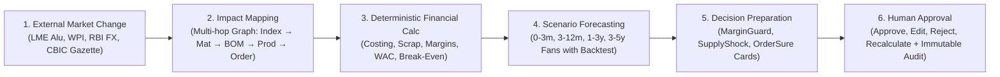

# MarginMind AI — Explainable Financial Intelligence & Decision Preparation Platform

[]()
[]()
[]()
[]()
[]()
[]()

> **MarginMind AI** is an explainable financial intelligence and decision-preparation platform for multi-industry manufacturing businesses.
> It continuously monitors external macroeconomic and commodity shifts, connects them to internal materials, bills of materials (BOM), supplier contracts, inventory, and customer orders, calculates exact deterministic financial consequences, projects multi-horizon scenario fans, and prepares evidence-backed decisions for human approval.

---

## 1. The Core Operational Workflow

MarginMind AI connects external shocks to executive balance-sheet decisions through a 6-stage closed loop:



---

## 2. Multi-Industry Architecture

MarginMind AI ships with extensible templates for 4 manufacturing sectors:
1. **Metal & Steel Manufacturing** *(Primary seed industry: Apex Precision Forging & Fabrication Ltd.)*
   - Hot-rolled steel billets, aluminium alloys, nickel wire, CNC machining power surcharges.
2. **Textile & Garment Manufacturing**
   - Combed cotton yarn, polyester staple fiber, reactive dyes, spinning/weaving energy costs.
3. **Electronics Assembly (EMS)**
   - FR-4 double-sided PCBs, lead-free solder paste, microcontrollers, passive passives.
4. **Food Processing & Packaging**
   - Refined palm oil, wheat flour grade-1, aseptic packaging pouches, pasteurization steam costs.

---

## 3. Core Specialized Engines

### 3.1 MarginGuard™ — Margin Surveillance & Erosion Decomposition
- Continuously monitors company products against configured **Target Margin** (e.g. 25%) and **Critical Margin** (e.g. 15%).
- When an external commodity shock erodes unit profitability below threshold, MarginGuard triggers real-time alerts, calculates margin variance decomposition (Raw Material vs. Direct Labour vs. Energy), and recommends the exact price revision required to restore target profitability.

### 3.2 SupplyShock™ — Sourcing Vulnerability & Buffer Diagnostics
- Evaluates supplier concentrations to detect single-source vulnerabilities.
- Calculates **Days of Supply (DOS)**:
  $$\text{Days of Supply} = \frac{\text{Current Inventory (kg)}}{\text{Daily Consumption Rate (kg/day)}}$$
- Identifies critical materials nearing supplier quotation expiration (< 15 days) and suggests alternative pre-qualified vendors.

### 3.3 OrderSure™ — Pre-Commitment Order Feasibility Gatekeeper
- Evaluates incoming or open customer purchase orders before management commits to delivery.
- Triages orders into 3 deterministic categories:
  - 🟢 **ATTRACTIVE** ($\text{Margin} \ge \text{Target Margin}$): Recommend immediate acceptance.
  - 🟡 **VERIFY** ($\text{Critical Margin} \le \text{Margin} < \text{Target Margin}$): Accept with volume renegotiation or partial delivery terms.
  - 🔴 **RISKY** ($\text{Margin} < \text{Critical Margin}$): Unprofitable order under current spot material costs. Suggests the minimum price floor or index-linked escalation clause required.

### 3.4 Multi-Horizon Forecasting Engine
- Projects conditional scenario fans across 4 critical planning horizons:
  - **0 to 3 Months:** Tactical procurement hedges and spot purchases.
  - **3 to 12 Months:** Annual customer contract pricing and budget locks.
  - **1 to 3 Years:** Tooling lifecycle, vendor agreements, and capital expenditure.
  - **3 to 5 Years:** Long-term product viability and portfolio phase-out strategy.
- Every horizon outputs **Favourable**, **Base**, and **Stress** cases.
- Validated via rolling time-based backtesting reporting MAE, RMSE, and MAPE.

### 3.5 Decision Preparation Centre & Human Approval State Machine
- **Non-Autonomous Principle:** AI models never execute binding business decisions autonomously.
- Generates structured decision dossiers:
  - **Recommended Action** & **Expected Financial Impact**.
  - **Key Trade-offs** & **Downside Risks**.
  - **Confidence Score** & **Epistemic Classification** (Fact, Signal, Model Projection, AI Interpretation).
- Human approvers have 4 state transitions:
  - `APPROVE`: Accept proposed values.
  - `EDIT_AND_APPROVE`: Modify selling price, allocation, or terms before signing off.
  - `REJECT`: Dismiss recommendation with mandatory reason.
  - `RECALCULATE`: Request refreshed calculations with updated parameters.
- All actions generate write-once, immutable audit entries with user ID, before/after values, and justification.

### 3.6 Document Intelligence & Provenance Tracking
- Extracts structured financial fields from CSV, XLSX, and multi-page PDFs (Supplier Quotations, Purchase Invoices, Customer Orders, BOMs).
- Tags every extracted field with a confidence score and document provenance (row, column, or page snippet).
- Dedicated Human-in-the-Loop verification drawer enables reviewing and correcting low-confidence extractions before committing to master records.

### 3.7 Executive Reporting Engine
- **PDF Executive Dossier:** Generated via ReportLab with tables, key metrics, and audit signatures.
- **Multi-Tab Excel Workbook:** Generated via openpyxl with formatted tabs for Portfolio Margins, Open Orders, Single-Source Risks, and Macro Indicators.

---

## 4. Technology Stack

- **Backend:** FastAPI, Python 3.12, SQLAlchemy, SQLite (Development) / PostgreSQL 16 (Production), Pydantic V2, bcrypt, python-jose, ReportLab, openpyxl, pandas, numpy, scikit-learn, statsmodels, pypdf.
- **Frontend:** React 18, TypeScript 5.2, Vite, Tailwind CSS, Lucide Icons, Recharts.
- **Testing:** pytest with 24 passing automated tests covering financial math, E2E workflow, document intelligence, ML anomaly detection, and multi-tenant isolation.
- **Containerization:** Docker, Docker Compose, Nginx.

---

## 5. Quick Start & Local Setup

### Prerequisites
- Python 3.12+
- Node.js 20+ and npm
- (Optional) Docker & Docker Compose

### 5.1 Backend Setup
```bash
cd backend

# Create and activate virtual environment
python3 -m venv .venv
source .venv/bin/activate

# Install dependencies
pip install -r requirements.txt

# Run database migrations and seed demonstration data
python -c "from backend.app.core.database import Base, engine; from backend.app.seeds.metal_demo import seed_metal_demonstration_data; Base.metadata.create_all(bind=engine); seed_metal_demonstration_data()"

# Run automated tests
PYTHONPATH=.. pytest backend/tests

# Start FastAPI development server
uvicorn backend.app.main:app --reload --port 8000
```
Backend API docs available at: `http://localhost:8000/docs`

### 5.2 Frontend Setup
```bash
cd frontend

# Install npm dependencies
npm install

# Build static assets
npm run build

# Start Vite development server
npm run dev
```
Frontend accessible at: `http://localhost:5173`

---

## 6. Docker Compose Deployment

To deploy the entire production stack (PostgreSQL 16 + FastAPI + Nginx Reverse Proxy):

```bash
# Clone and enter repository
git clone <repo-url> marginmind
cd marginmind

# Launch containers
docker-compose up -d --build

# Verify running services
docker-compose ps
```
- Web Application: `http://localhost:3000`
- API Health Check: `http://localhost:3000/health`

---

## 7. Demonstration Dataset Walkthrough

MarginMind AI comes pre-loaded with **Apex Precision Forging & Fabrication Ltd.**, an AS9100-certified tier-2 aerospace and heavy automotive component manufacturer in Pune, India.

### Pre-Configured Demo Credentials:
| Role | Email | Password | Permissions |
| :--- | :--- | :--- | :--- |
| **Business Owner** | `owner@apexforge.com` | `password123` | Full access & final approval authority |
| **Finance Manager** | `finance@apexforge.com` | `password123` | Cost sheets, pricing models, report downloads |
| **Procurement Manager**| `procurement@apexforge.com`| `password123` | Sourcing, supplier quotes, purchase orders |
| **Production Manager** | `production@apexforge.com` | `password123` | BOM specs, capacity, inventory, order queue |

### Quick Demo Workflow:
1. **Login:** Use the one-click quick switch buttons on the login screen to sign in as **Business Owner**.
2. **Dashboard Overview:** Review the portfolio gross margin (28.4%), inventory buffer (38 days), and pending approval count.
3. **Simulate Market Shock:** Navigate to **Market Intelligence** or **Scenario Simulator**. Apply a **+15.0% shock to LME Aluminium**.
4. **Inspect Propagation:** Notice how MarginMind traces the shock to *Aluminium 6061-T6*, which is used in *Aviation Bracket AS-21* and *Automotive Transmission Housing*.
5. **Review OrderSure™:** Navigate to **OrderSure™** and observe how *Customer Order ORD-2026-089 (Boeing Tier-1)* status transitions to **VERIFY** due to compressed gross margin (18.6%).
6. **Decision Preparation Centre:** Navigate to **Decision Centre**. Inspect the prepared decision to adjust the price of *Aviation Bracket AS-21* from ₹8,500 to ₹9,450.
7. **Human Approval:** Click **Edit & Approve**, adjust the target price to ₹9,300 with note *"Agreed concession for Q3 delivery schedule"*, and confirm.
8. **Audit Trail:** Navigate to **Approval History** to view the immutable audit trail with before/after delta and timestamp.
9. **Export Reports:** Navigate to **Executive Reports** and download the PDF Executive Briefing or multi-tab Excel Workbook.

---

## 8. Automated Test Suite

The system includes 24 automated unit, integration, and E2E tests:
- `backend/tests/test_financial_engine.py`: Product costing, BOM scrap allowances, order economics, WAC inventory, and break-even math.
- `backend/tests/test_e2e_metal_workflow.py`: End-to-end shock propagation, decision cards, approval actions, and audit logs.
- `backend/tests/test_document_extractor.py`: CSV/XLSX tabular extraction, confidence scoring, provenance, and human correction.
- `backend/tests/test_ml_anomaly.py`: Statistical modified Z-score (MAD), constant history handling, and multivariate Isolation Forest.
- `backend/tests/test_tenant_isolation.py`: Strict multi-tenant row-level data segregation between businesses.

Run all tests:
```bash
PYTHONPATH=. backend/.venv/bin/pytest backend/tests -v
```

---

## 9. License & Commercial Information

MarginMind AI is proprietary software engineered for manufacturing enterprises. All rights reserved.
For enterprise licensing, on-premise air-gapped deployments, and custom ERP integration adaptors, contact the MarginMind engineering team.
