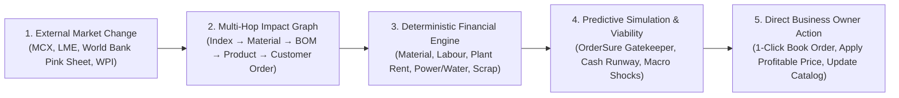
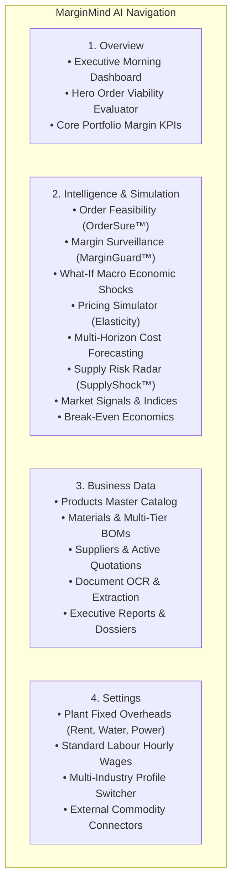

# MarginMind AI — Explainable Financial Intelligence & Predictive Simulation Platform

[]()
[]()
[]()
[]()
[]()
[]()

> **MarginMind AI** is an explainable financial intelligence and predictive operating system engineered for manufacturing business owners and plant operators.
> It continuously monitors external macroeconomic commodity shifts, connects them to internal materials, bills of materials (BOM), supplier contracts, inventory, and customer purchase orders, calculates exact deterministic financial consequences, projects multi-horizon scenario fans, and provides instant order viability evaluations and keep/drop advisories.

---

## 1. The Core Operational Workflow

MarginMind AI connects external commodity volatility to executive plant decisions through a closed predictive loop:



---

## 2. The 4 Unified Workspaces

The platform is organized into 4 dedicated, non-overlapping workspaces:



---

## 3. Multi-Industry Architecture

MarginMind AI ships with extensible templates for 4 manufacturing verticals:

1. **Metal & Steel Manufacturing** *(Seed Industry: Apex Precision Forging & Fabrication Ltd.)*
   - Hot-rolled steel billets, aluminium alloys, nickel wire, CNC power surcharges, and aerospace forgings.
2. **Textile & Garment Manufacturing**
   - Combed cotton yarn, polyester staple fiber, reactive dyes, spinning/weaving energy, and finished twill garments.
3. **Electronics Assembly (EMS / SMT)**
   - FR-4 double-sided PCBs, lead-free solder paste, microcontrollers, and surface-mount assembly costs.
4. **Food Processing & Packaging**
   - Refined edible oils, wheat flour, aseptic pouches, and boiler/pasteurization steam utility costs.

---

## 4. Core Specialized Engines

### 4.1 MarginGuard™ — Margin Surveillance & Variance Decomposition
- Continuously monitors portfolio products against configured **Target Margin** (e.g. 25%) and **Critical Margin Floor** (e.g. 16%).
- When external commodity spikes erode unit profitability, MarginGuard pinpoints the exact driver (Raw Material vs. Labour vs. Plant Overhead) and recommends the exact price adjustment required to restore target profitability.

### 4.2 Deep Order Viability Evaluator & OrderSure™
- Acts as the operational gatekeeper before accepting any customer contract or purchase order.
- Answers 3 core questions:
  1. **Is It Profitable?** Compares Total Revenue against Total Production Cost to compute Net Profit and Gross Margin %.
  2. **Money I Have vs. Money I Must Spend:** Decomposes cash outflow across the 5 pillars:
     - **Raw Material Spend:** Required BOM quantities at spot prices.
     - **Direct Labour Spend:** Required crew hours and wages.
     - **Plant Rent & Facilities:** Absorbed monthly factory overhead.
     - **Production Supplies & Utilities:** Electricity and water costs.
     - **Time & Cash Runway:** Production days needed and cash runway safety check against working capital.
  3. **Future Sensitivity & Keep/Drop Advisory:**
     - Simulates +10% to +18% raw material inflation surges.
     - Outputs clear guidance: `KEEP_ORDER`, `RENEGOTIATE_PRICE`, `KEEP_BUT_LOCK_SUPPLIER`, or `DROP_ORDER`.
     - Direct 1-click **`Apply Profitable Price (₹...)`** button to re-evaluate and restore margins instantly.

### 4.3 SupplyShock™ — Sourcing Vulnerability & Buffer Diagnostics
- Identifies single-source dependencies and computes **Days of Supply (DOS)**:
  $$\text{Days of Supply} = \frac{\text{Current Inventory (kg)}}{\text{Daily Consumption Rate (kg/day)}}$$
- Alerts when material buffers drop below 15 days and surfaces pre-qualified alternate vendors.

### 4.4 What-If Macro Economic Shock Simulator
- Propagates price shocks across multi-tier BOMs via the Knowledge Graph.
- Allows testing commodity price spikes (+5% to +35%), energy rate hikes, and wage increases to reveal factory-wide cost increases and at-risk product lines.

### 4.5 Pricing Simulator (Elasticity Engine) & Break-Even Economics
- Microeconomic demand elasticity modeling: drag price sliders (-30% to +50%) to see projected customer order volume changes, unit margins, and annual bottom-line profit.
- Computes monthly break-even unit volumes and unit contribution margins.

### 4.6 Document Intelligence & Instant 1-Click Master Booking
- Extracts structured fields from customer purchase orders, RFQs, vendor invoices, and quotation files (PDF, CSV, XLSX).
- Direct 1-click action buttons:
  - **Book as Customer Order**: Inserts the contract directly into OrderSure.
  - **Save to Products**: Adds the item with its unit economics to master products.
  - **Save Supplier Quotation**: Registers the quote into vendor pricing history.

### 4.7 Executive Reporting Engine
- **PDF Executive Dossier:** Board-ready multi-page report generated via ReportLab summarizing plant margins, risk alerts, and order book economics.
- **Financial Telemetry Matrix (Excel):** Multi-tab spreadsheet generated via openpyxl with BOM cost decompositions, inventory levels, and supplier quotes.

---

## 5. Technology Stack

- **Backend:** FastAPI, Python 3.12, SQLAlchemy, SQLite (Dev) / PostgreSQL 16 (Prod), Pydantic V2, bcrypt, python-jose, ReportLab, openpyxl, pandas, numpy, scikit-learn, statsmodels, pypdf.
- **Frontend:** React 18, TypeScript 5.2, Vite, Tailwind CSS, Lucide Icons, Recharts.
- **Testing:** pytest with **36 passing automated tests** covering financial math, multi-industry E2E workflows, document intelligence, order viability, deletion safety, and tenant isolation.
- **Containerization:** Docker, Docker Compose, Nginx.

---

## 6. Quick Start & Local Setup

### Prerequisites
- Python 3.12+
- Node.js 20+ and npm

### 6.1 Backend Setup
```bash
cd backend

# Create and activate virtual environment
python3 -m venv .venv
source .venv/bin/activate

# Install dependencies
pip install -r requirements.txt

# Run database migrations and seed demonstration data
python -c "from backend.app.core.database import Base, engine; from backend.app.seeds.metal_demo import seed_metal_demonstration_data; Base.metadata.create_all(bind=engine); seed_metal_demonstration_data()"

# Run automated tests (36 tests)
PYTHONPATH=.. pytest backend/tests

# Start FastAPI development server
uvicorn backend.app.main:app --reload --port 8000
```
Backend API docs available at: `http://localhost:8000/docs`

### 6.2 Frontend Setup
```bash
cd frontend

# Install npm dependencies
npm install

# Build static assets (0 TypeScript errors)
npm run build

# Start Vite development server
npm run dev
```
Frontend accessible at: `http://localhost:5173`

---

## 7. Demonstration Dataset Walkthrough

MarginMind AI comes pre-loaded with **Apex Precision Forging & Fabrication Ltd.**, an AS9100-certified tier-2 aerospace and heavy automotive component manufacturer.

### Single Business Owner Profile
- **Role:** Business Owner & Principal Operator
- **Email:** `owner@apexforge.com`
- **Password:** `password123`
- *Note:* The application operates strictly in single-owner mode with direct administrative authority over plant overheads, pricing, and orders.

### Quick Demo Workflow
1. **Overview Dashboard:** Review portfolio gross margin (28.4%), active monitored products, and the hero **Order Viability Evaluator**.
2. **Instant Order Evaluation:** Enter 500 units @ ₹8,500. View the spend breakdown across Raw Materials, Labour, Rent, Utilities, and the Cash Runway check.
3. **Intelligence & Simulation:** Navigate to **Intelligence & Simulation**:
   - Check **Order Feasibility** to view open customer contracts and keep/drop verdicts.
   - Run a **What-If Shock** (+15% to LME Aluminium) to see cost propagation across BOMs.
   - Test price adjustments on the **Pricing Simulator** elasticity curve.
4. **Business Data Management:** Navigate to **Business Data**:
   - View finished goods under **Products** with real raw material and labour costs.
   - Inspect raw materials and in-stock inventory valuations under **Materials & BOM**.
   - Drop a quotation or order document under **Documents** to extract and book with 1 click.
5. **Quick Export:** Click **Quick Export** in the top header to generate an Executive Margin Dossier (PDF) or Financial Telemetry Matrix (Excel).

---

## 8. Automated Test Suite (36 Tests)

All 36 tests pass cleanly:
- `backend/tests/test_order_viability.py`: Cash runway, spend breakdown, inflation sensitivity, and keep/drop advisory.
- `backend/tests/test_financial_engine.py`: Product costing, BOM scrap allowances, order economics, WAC inventory, and break-even math.
- `backend/tests/test_delete_features.py`: Safe cascade deletion of products, orders, materials, and quotations.
- `backend/tests/test_document_extractor.py`: Tabular/PDF extraction, confidence scoring, provenance, and structured review.
- `backend/tests/test_e2e_metal_workflow.py`: End-to-end shock propagation, margin variance, and pricing adjustments.
- `backend/tests/test_textile_garment_workflow.py`: Textile BOM recipes, cotton price volatility, and fabric margin tracking.
- `backend/tests/test_all_industries_workflow.py`: Seed verification across Metal, Textile, Electronics, and Food verticals.
- `backend/tests/test_forecasting_scenarios.py`: Multi-horizon projections (0-3m, 3-12m, 1-3y, 3-5y).
- `backend/tests/test_ml_anomaly.py`: Statistical modified Z-score (MAD) and multivariate Isolation Forest.
- `backend/tests/test_tenant_isolation.py`: Strict multi-tenant row-level data segregation.

Run the test suite:
```bash
cd /Users/sindhubhat/.gemini/antigravity/scratch/marginmind
PYTHONPATH=. backend/.venv/bin/pytest backend/tests -v
```

---

## 9. License

MarginMind AI is proprietary software engineered for manufacturing enterprises. All rights reserved.
