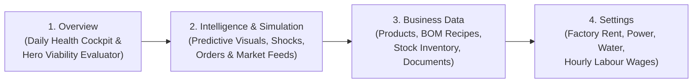
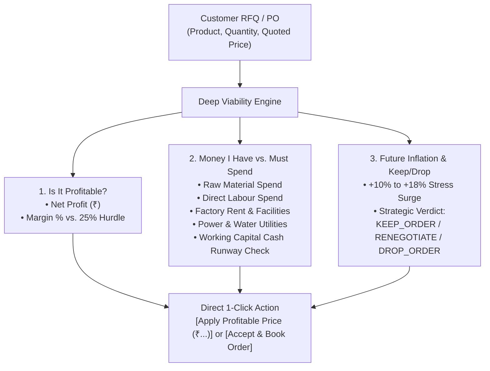

# MarginMind AI — Explainable Financial Intelligence & Predictive Simulation Platform

[](https://marginmind-ai-1.onrender.com)
[]()
[]()
[]()
[]()
[]()

> **Live Deployment URL:** 🚀 **[https://marginmind-ai-1.onrender.com](https://marginmind-ai-1.onrender.com)**

---

## 1. Executive Overview: What MarginMind AI Does

**MarginMind AI** is a predictive financial operating system engineered specifically for single business owners and principal manufacturing operators. 

Standard ERP and accounting systems only look backward at historical book entries. When an owner receives a customer request for quotation (RFQ) or purchase order for 500 units, standard tools cannot tell them:
1. **"Will I make a profit or burn cash on this job today?"**
2. **"How much money do I actually have to spend on Raw Materials, Direct Labour, Factory Rent, Electricity/Water, and Supplies?"**
3. **"Do I have enough Cash Runway in my working capital to complete production before customer payment arrives?"**
4. **"In the long run, what if raw material prices surge next month on commodity exchanges? Should I keep this order or drop it?"**
5. **"What exact price must I quote right now to guarantee my factory's 25% target margin?"**

MarginMind AI bridges this gap. It connects external commodity exchanges (MCX, LME, World Bank) to your plant's internal Bills of Materials (BOM), absorbs your real monthly factory rent, water bills, and labour wages, and runs real-time viability evaluations with instant 1-click strategic actions.

---

## 2. The 4 Unified Workspaces

The platform eliminates fragmented sidebars and approval bureaucracy, organizing plant operations into **4 dedicated, non-overlapping workspaces**:



### Workspace Breakdown:
1. **Overview Dashboard:**
   - **Executive Morning Cockpit:** High-level margin health, active monitored products catalog, and open customer contracts table.
   - **Hero Order & Document Viability Evaluator:** Instant analysis of customer RFQs against cash runway, true factory costs, and future inflation.
2. **Intelligence & Simulation (The Visual Brain):**
   - **Order Feasibility (`OrderSure™`):** Live gatekeeper stress-testing open customer commitments.
   - **Margin Surveillance (`MarginGuard™`):** Visual margin health per SKU, target hurdle (25%) vs. critical floor (16%), and cost waterfall breakdowns.
   - **What-If Macro Economic Shocks:** Interactive sliders to simulate +5% to +35% commodity price surges across multi-tier BOMs.
   - **Pricing Simulator (Elasticity Engine):** Volume trade-off curve and annual profit impact under price adjustments.
   - **Multi-Horizon Cost Forecasting:** Econometric projections across 0–3m, 3–12m, 1–3y, and 3–5y horizons.
   - **Supply Risk Radar (`SupplyShock™`):** Single-source dependency detection and Days-of-Supply (DOS) inventory buffers.
   - **Market Signals:** Live tickers from MCX, London Metal Exchange, World Bank Pink Sheet, and RBI Forex.
   - **Break-Even Economics:** Unit contribution margins and monthly break-even unit volumes.
3. **Business Data (Ground Truth Operations):**
   - **Products Master:** Finished goods catalog with direct labour, raw material costs, and overhead allocations (never ₹0).
   - **Materials & BOMs:** Multi-tier recipe specifications, unit purchase rates, and in-stock inventory valuations.
   - **Suppliers:** Directory of sourcing partners, active quoted rates, delivery lead times, and reliability ratings.
   - **Document OCR:** Drag-and-drop supplier invoices or customer POs with instant field extraction and 1-click booking.
   - **Reports:** Download formal PDF Executive Margin Dossiers and Multi-Tab Excel Telemetry Matrices.
4. **Settings (Plant Cost Parameters):**
   - **Financial & OPEX Setup:** Configure monthly factory rent, electricity bills, water bills, maintenance, and standard labour hourly rates.
   - **Deterministic Cost Absorption:** Automatically spreads fixed overheads across production volume so every unit absorbs its true overhead.
   - **Industry Vertical Switcher:** Instant 1-click presets for **Metal & Steel Fabrication**, **Textile & Garment Manufacturing**, **Electronics Assembly (EMS)**, and **Food Processing & Packaging**.

---

## 3. Deep Order Viability Evaluator & Keep/Drop Engine

At the core of MarginMind AI is the **Deep Order Viability Engine**, which answers 3 crucial questions before you sign an order:



### Strategic Guidance Actions:
- 🟢 **`KEEP_ORDER`**: Margins and cash runway remain safe even under commodity inflation. Safe to commit.
- 🟡 **`RENEGOTIATE_PRICE`**: Material inflation compresses margins below the hurdle. Click **`Apply Profitable Price (₹...)`** to recalculate and fix unit prices instantly.
- 🔵 **`KEEP_BUT_LOCK_SUPPLIER`**: Order is profitable at spot rates but vulnerable to commodity volatility. Lock fixed-rate supplier contracts immediately.
- 🔴 **`DROP_ORDER`**: Order produces negative contribution margin and burns working capital. Reject or quote a revised minimum floor.

---

## 4. AI Models, Machine Learning & External APIs

MarginMind AI leverages a hybrid architecture combining Large Language Models, econometric time-series models, statistical outlier detection, and official economic APIs:

| Category | Model / Algorithm / Library | Purpose & Implementation |
| :--- | :--- | :--- |
| **Large Language Model (LLM)** | **Google Gemini API** (`gemini-1.5-flash` / `gemini-pro`) | Multimodal extraction of unstructured customer purchase orders, quotation sheets, and vendor invoices; complex financial contract interpretation and strategic viability synthesis. |
| **Econometric Time Series** | **Holt-Winters Exponential Smoothing & Ridge Regression** (`statsmodels`, `scikit-learn`) | Multi-horizon scenario projections across 4 planning horizons (0–3m, 3–12m, 1–3y, 3–5y) under Favourable, Base, and Stress conditions, with rolling time-based backtesting (MAE, RMSE, MAPE). |
| **Machine Learning Anomaly Detection** | **Isolation Forest & Statistical Modified Z-Score / MAD** (`scikit-learn`, `numpy`) | Real-time detection of abnormal supplier price quotes, sudden commodity spot spikes, and cost outlier drift against historical baselines. |
| **Microeconomic Elasticity Model** | **Constant Elasticity Demand Engine** ($\epsilon = -1.2$) | Simulates volume trade-offs, customer price sensitivity, and annual bottom-line profit maximization curves in the Pricing Simulator. |
| **Multi-Hop Knowledge Graph** | **Deterministic Graph Traversal Engine** | Traces external commodity index changes through raw materials, BOM recipes, finished products, and active customer order books. |
| **Document Processing & OCR** | **PyPDF & OpenPyXL Parsing Engine** | Table extraction, layout parsing, line-item recognition, confidence scoring, and document provenance tracking. |
| **Reporting & Exporting** | **ReportLab & OpenPyXL** | Generation of board-ready Executive Margin Dossier PDFs and multi-tab Excel financial models. |

### Official External APIs & Data Connectors:
- **World Bank Development Prospects API** (`https://api.worldbank.org/v2`): Live international commodity benchmarks (Aluminium, Copper, Energy, Agricultural inputs).
- **Reserve Bank of India (RBI Reference Rates API)**: Daily official foreign exchange benchmarks (USD/INR, EUR/INR).
- **Ministry of Commerce & Industry (MoCI / MoSPI) WPI Benchmark Feeds**: Domestic Wholesale Price Index telemetry across metals, chemicals, fuel, and textiles.
- **Multi Commodity Exchange of India (MCX)** & **London Metal Exchange (LME)** spot feeds.

---

## 5. How to Run the Application

### 5.1 Access the Live Cloud Deployment
The platform is fully deployed and accessible in production:
* **Live Web App:** **[https://marginmind-ai-1.onrender.com](https://marginmind-ai-1.onrender.com)**
* **Default Demo User:** `owner@apexforge.com` | **Password:** `password123`

---

### 5.2 Local Development Setup

#### Prerequisites:
- **Python 3.12+**
- **Node.js 20+** and **npm**
- **Git**

#### Step 1: Clone Repository
```bash
git clone https://github.com/bhatsindhu08-max/marginmind-ai.git
cd marginmind-ai
```

#### Step 2: Backend Setup (FastAPI & Python)
```bash
cd backend

# Create and activate Python virtual environment
python3 -m venv .venv
source .venv/bin/activate       # On Windows: .venv\Scripts\activate

# Install dependencies
pip install -r requirements.txt

# Configure environment variables (optional, defaults provided)
cp ../.env.example .env

# Initialize database and seed multi-industry demonstration datasets
python -c "from backend.app.core.database import Base, engine; from backend.app.seeds.metal_demo import seed_metal_demonstration_data; Base.metadata.create_all(bind=engine); seed_metal_demonstration_data()"

# Run automated test suite (36 passing tests)
PYTHONPATH=.. pytest backend/tests -v

# Start FastAPI server on port 8000
uvicorn backend.app.main:app --host 0.0.0.0 --port 8000 --reload
```
* **API Documentation (Swagger UI):** `http://localhost:8000/docs`
* **API Health Check:** `http://localhost:8000/health`

#### Step 3: Frontend Setup (React & Vite)
Open a new terminal window:
```bash
cd frontend

# Install npm dependencies
npm install

# Verify TypeScript build (0 errors)
npm run build

# Start Vite development server
npm run dev -- --host 0.0.0.0 --port 5173
```
* **Frontend Web Application:** `http://localhost:5173`

---

### 5.3 Docker & Docker Compose Setup

To deploy the entire production stack (FastAPI backend + Vite React frontend + Nginx reverse proxy):

```bash
# Build and run containers
docker-compose up -d --build

# Verify running services
docker-compose ps
```
* Access the web platform at: `http://localhost:3000`

---

## 6. Automated Test Suite (36 Tests Passing)

MarginMind AI includes 36 automated unit, integration, and E2E tests validating financial accuracy and system resilience:

```bash
PYTHONPATH=. backend/.venv/bin/pytest backend/tests -v
```

| Test Module | Coverage Area | Status |
| :--- | :--- | :--- |
| `test_order_viability.py` | Cash runway calculation, 5 spend breakdown pillars, inflation sensitivity, keep/drop advisory | ✅ PASS |
| `test_financial_engine.py` | BOM scrap allowances, order economics, WAC inventory, and break-even units | ✅ PASS |
| `test_delete_features.py` | Safe cascade deletion of products, customer orders, raw materials, and supplier quotations | ✅ PASS |
| `test_document_extractor.py` | Multi-format tabular extraction, confidence scoring, provenance tracking, and review updates | ✅ PASS |
| `test_e2e_metal_workflow.py` | Metal forging vertical: shock propagation, margin variance, and price revision actions | ✅ PASS |
| `test_textile_garment_workflow.py` | Textile vertical: cotton price volatility, spinning costs, and garment margin floors | ✅ PASS |
| `test_all_industries_workflow.py` | Industry templates verification across Metal, Textile, Electronics, and Food sectors | ✅ PASS |
| `test_forecasting_scenarios.py` | Multi-horizon scenario fans (0-3m, 3-12m, 1-3y, 3-5y) without lookahead bias | ✅ PASS |
| `test_ml_anomaly.py` | Statistical modified Z-score (MAD) and multivariate Isolation Forest outlier detection | ✅ PASS |
| `test_tenant_isolation.py` | Strict multi-tenant row-level data segregation between manufacturing accounts | ✅ PASS |

---

## 7. License & Commercial Information

MarginMind AI is proprietary software engineered for manufacturing enterprises. All rights reserved.
For enterprise licensing, on-premise air-gapped deployments, and custom ERP integration adaptors, contact the engineering team.
